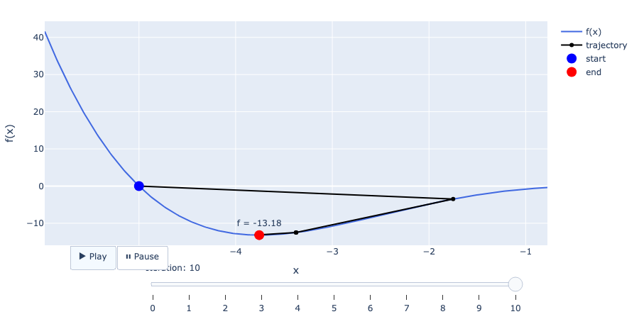
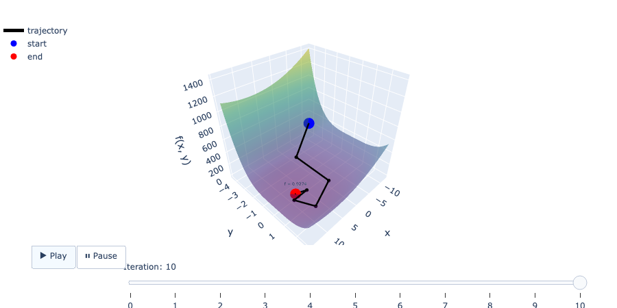
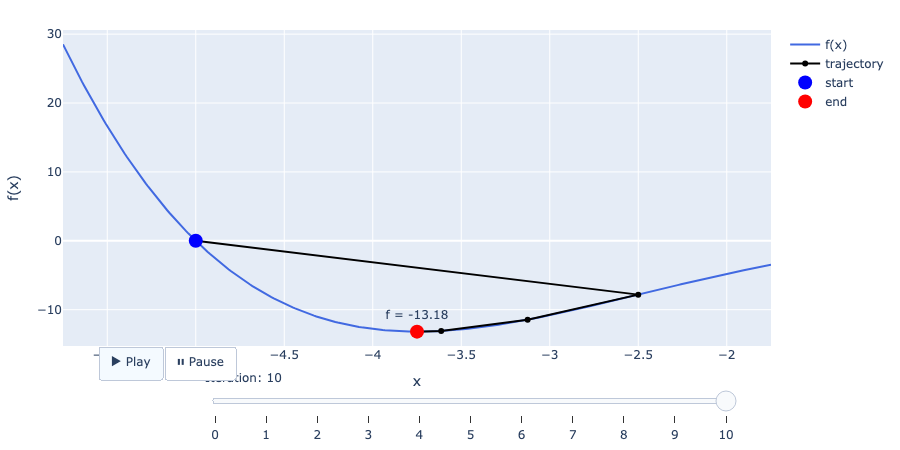
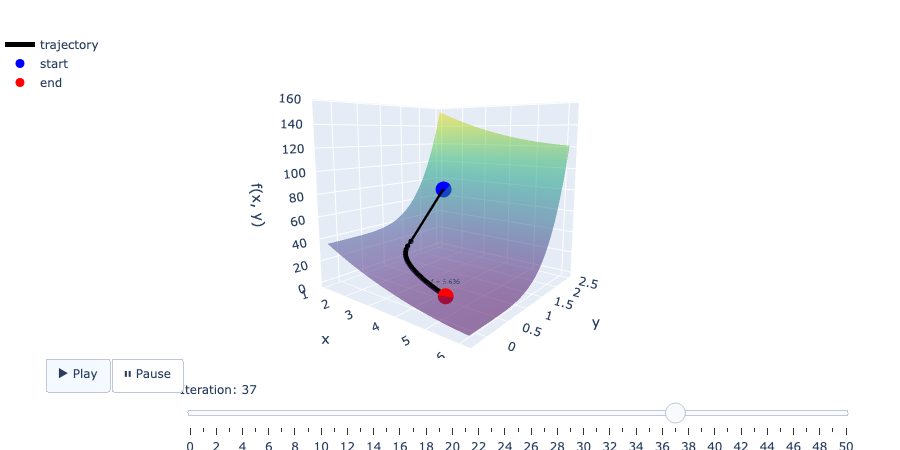
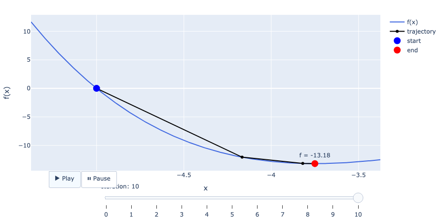
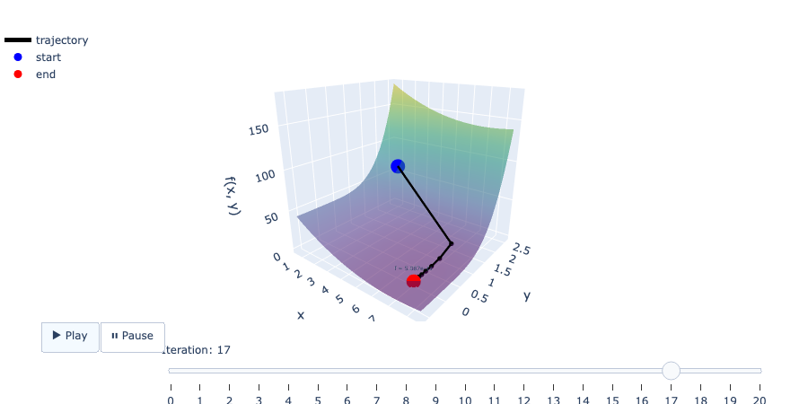

# Optimization Algorithms

A compact, fully self-contained framework for numerical optimization and visualization, where the mathematical part is written in **“vanilla” Python** without using any third-party mathematical or optimization libraries. All basic mathematical operations, including the calculation of derivatives, gradients, the Hessian matrix, its inverse, and the implementation of point-updating algorithms (search for best and worst points), are written “from scratch” to provide a deep understanding of the inner workings of numerical methods.

This project allows you to specify arbitrary objective functions, select starting points, set the number of iterations, and explore the behavior of classical optimization algorithms in an interactive environment.

---

## 📂 Project Architecture

The project has a modular structure:

* **`optimization.py`** — contains the basic mathematical engines:
  * Calculation of derivatives and gradients.
  * Construction of the Hessian matrix and algorithms for its inversion.
  * Logic for finding best and worst points for adaptive update algorithms.
* **`optimization_methods.py`** — contains a collection of ready-to-use optimization algorithms (the Nelder-Mead method, the Gradient Descent method, and the Newton method), built from the primitives of the previous module.
* **`visualization.py`** — tools for constructing two-dimensional and three-dimensional graphs. It has built-in support for interactive rendering (Plotly) with automatic saving of results in `.html` format and static `.png` images.
* **`functions.py`** — a module containing basic test functions (e.g., $f_{0}(x) = \frac{1}{5}x^4 + x^3$ and $f_{1}(x, y) = (x-7)^2 + 3y^4$). The structure makes it easy to add your own functions for testing.
* **`Optimization_Demo.ipynb`** — a demonstration Jupyter Notebook that clearly illustrates examples of initialization, running algorithms, and analyzing results.

---

## ⚙️ Usage and Expansion

In the basic configuration, we use functions from the `functions.py` file:
1. **Function 1:** $f_{0}(x) = \frac{1}{5}x^4 + x^3$
2. **Function 2:** $f_{1}(x, y) = (x-7)^2 + 3y^4$

> You can easily extend the `functions.py` file with your own mathematical functions and test how all optimization algorithms work with them.

---

## 📊 Examples and Results of Execution

Below are the results of testing three main optimization algorithms for two test functions (6 scenarios).

Each method is accompanied by an interactive HTML report/visualization and a static preview.

### 1. Nelder-Mead Optimization
An adaptive deformed polygon (simplex) method that does not require the calculation of derivatives.

- **For Function 1 ($f_{1}$):**
  * 🔗 [Open Interactive HTML Report (2D)](https://htmlpreview.github.io/?https://github.com/ihormukhahaha/optimization-algorithms/blob/main/html/nelder_mead_method_2d.html)
  * Static optimization trajectory preview:
    

- **For Function 2 ($f_{2}$):**
  * 🔗 [Open Interactive HTML Report](https://htmlpreview.github.io/?https://github.com/ihormukhahaha/optimization-algorithms/blob/main/html/nelder_mead_method_3d.html)
  * Static optimization trajectory preview:
    

---

### 2. Gradient Descent
A first-order optimization method that uses the anti-gradient for iterative movement toward the function's minimum.

- **For Function 1 ($f_{1}$):**
  * 🔗 [Open Interactive HTML Report (2D)](https://htmlpreview.github.io/?https://github.com/ihormukhahaha/optimization-algorithms/blob/main/html/gradient_descent_method_2d.html)
  * Static optimization trajectory preview:
    

- **For Function 2 ($f_{2}$):**
  * 🔗 [Open Interactive HTML Report](https://htmlpreview.github.io/?https://github.com/ihormukhahaha/optimization-algorithms/blob/main/html/gradient_descent_method_3d.html)
  * Static optimization trajectory preview:
    

---

### 3. Newton's Method
A second-order optimization method that utilizes both the gradient and the inverse Hessian matrix for rapid quadratic approximation to the minimum.

- **For Function 1 ($f_{1}$):**
  * 🔗 [Open Interactive HTML Report (2D)](https://htmlpreview.github.io/?https://github.com/ihormukhahaha/optimization-algorithms/blob/main/html/newtons_method_2d.html)
  * Static optimization trajectory preview:
    

- **For Function 2 ($f_{2}$):**
  * 🔗 [Open Interactive HTML Report](https://htmlpreview.github.io/?https://github.com/ihormukhahaha/optimization-algorithms/blob/main/html/newtons_method_3d.html)
  * Static optimization trajectory preview:
    
